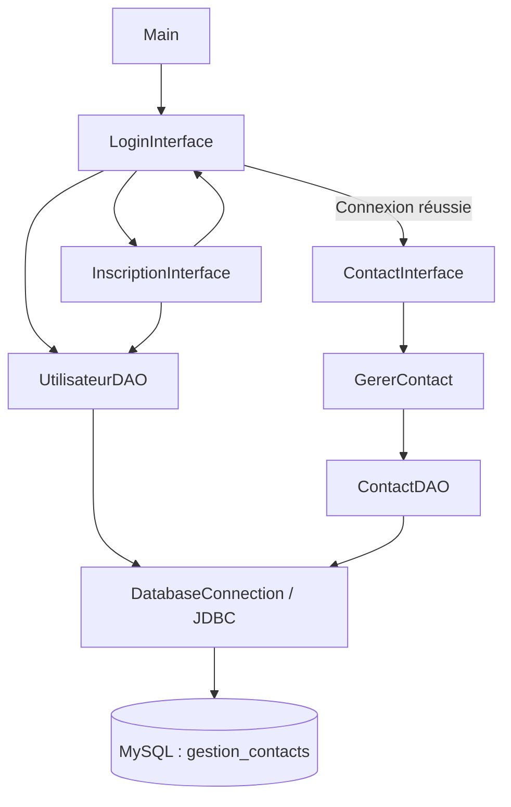
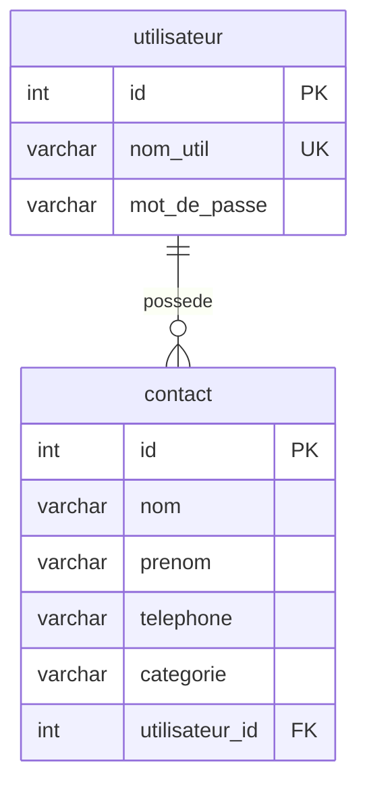

<div align="center"> 
  
# Gestion de contacts — Application Java

**Application de bureau multi-utilisateur pour organiser, rechercher et gérer ses contacts avec Java Swing, JDBC et MySQL.**
</div>

Ce projet propose un carnet de contacts personnel accessible après inscription et connexion. Chaque utilisateur peut consulter ses contacts, les classer par catégorie et effectuer les opérations de création, de modification et de suppression depuis une interface graphique en français.

**Technologies clés :** Java · Swing / AWT · JDBC · MySQL · MySQL Connector/J


## Sommaire

- [Présentation du projet](#présentation-du-projet)
- [Contexte et problématique](#contexte-et-problématique)
- [Objectifs](#objectifs)
- [Fonctionnalités principales](#fonctionnalités-principales)
- [Architecture du système](#architecture-du-système)
- [Parcours utilisateur](#parcours-utilisateur)
- [Stack technique](#stack-technique)
- [Modèle de données](#modèle-de-données)
- [Installation et configuration](#installation-et-configuration)
- [Compilation et lancement](#compilation-et-lancement)
- [Structure du projet](#structure-du-projet)
- [Sécurité et accès aux données](#sécurité-et-accès-aux-données)
- [Tests et validation](#tests-et-validation)
- [Dépannage](#dépannage)
- [Limites actuelles](#limites-actuelles)
- [Améliorations envisagées](#améliorations-envisagées)
- [Contribution](#contribution)
- [Auteur](#auteur)
- [Licence](#licence)

## Présentation du projet

**Gestion de contacts** est une application Java de bureau qui associe une interface Swing à une base de données MySQL. Elle couvre deux domaines fonctionnels :

1. **La gestion des comptes** : inscription, vérification de l'existence d'un nom d'utilisateur et authentification.
2. **La gestion des contacts** : consultation, ajout, recherche par nom, modification et suppression des contacts rattachés au compte connecté.

Le code est organisé autour de modèles métier, d'interfaces graphiques, d'une couche de gestion des contacts et d'objets d'accès aux données suivant le modèle **DAO — Data Access Object**.


## Contexte et problématique

Les coordonnées personnelles et professionnelles peuvent être dispersées entre différents supports. Un carnet de contacts structuré permet de centraliser ces informations et de les retrouver plus facilement.

L'application répond à ce besoin par :

- Une interface graphique dédiée aux opérations courantes.
- Un carnet associé à chaque compte utilisateur.
- Des catégories simples : **Famille**, **Amis** et **Travail**.
- Une recherche par nom mise à jour à chaque modification du champ de recherche.
- Un stockage persistant dans MySQL plutôt qu'une conservation limitée à la mémoire de l'application.

## Objectifs

1. Centraliser les informations essentielles d'un contact : nom, prénom, téléphone et catégorie.
2. Rattacher les contacts à leur propriétaire dans les requêtes de l'application.
3. Simplifier les opérations de création, de consultation, de modification et de suppression.
4. Faciliter la recherche d'un contact par une partie de son nom.
5. Séparer l'affichage, les objets métier et les accès SQL.
6. Fournir une base de travail pour approfondir Java Swing, JDBC et la persistance relationnelle.

## Fonctionnalités principales

| Domaine | Fonctionnalités implémentées |
| --- | --- |
| Inscription | Saisie d'un nom d'utilisateur, d'un mot de passe et de sa confirmation ; contrôle des champs vides et des noms déjà utilisés. |
| Authentification | Vérification des identifiants en base et ouverture du carnet associé à l'utilisateur. |
| Consultation | Affichage des contacts dans un tableau avec nom, prénom, téléphone et catégorie. |
| Ajout | Création d'un contact après vérification que le nom, le prénom et le téléphone ne sont pas vides. |
| Modification | Préremplissage du formulaire à partir d'une ligne sélectionnée et mise à jour via le bouton **Modifier**. |
| Suppression | Suppression du contact sélectionné via le bouton **Supprimer**. |
| Recherche | Filtrage par nom avec une requête SQL `LIKE`, déclenché pendant la saisie. |
| Catégorisation | Choix entre **Famille**, **Amis** et **Travail** dans le formulaire. |
| Persistance | Lecture et écriture dans MySQL avec des requêtes JDBC paramétrées. |
| Retour utilisateur | Messages de validation dans les formulaires et confirmation d'inscription par boîte de dialogue. |


## Architecture du système

### Organisation en couches

| Couche | Classes principales | Responsabilité |
| --- | --- | --- |
| Point d'entrée | `Main` | Démarrer l'interface sur le thread Swing et enregistrer la fermeture de la connexion à l'arrêt du processus. |
| Présentation | `LoginInterface`, `InscriptionInterface`, `ContactInterface` | Afficher les fenêtres, collecter les saisies et traiter les événements utilisateur. |
| Gestion des contacts | `GererContact` | Maintenir la liste des contacts chargés et déléguer les opérations aux DAO. |
| Modèles | `Utilisateur`, `Contact` | Représenter les comptes et les contacts en mémoire. |
| Accès aux données | `UtilisateurDAO`, `ContactDAO` | Exécuter les requêtes SQL paramétrées et convertir les résultats en objets Java. |
| Connexion | `DatabaseConnection` | Fournir une connexion JDBC partagée vers MySQL. |



### Flux de données

1. L'utilisateur saisit ses identifiants dans `LoginInterface`.
2. `UtilisateurDAO` interroge la table `utilisateur` avec un `PreparedStatement`.
3. En cas de succès, l'identifiant du compte est transmis à `ContactInterface`.
4. `GererContact` crée un `ContactDAO` associé à cet identifiant et charge les contacts correspondants.
5. Les opérations sur les contacts sont exécutées en base, puis la liste est rechargée après une écriture réussie.
6. La recherche interroge directement la base avec le nom saisi et l'identifiant de l'utilisateur.


## Parcours utilisateur

### Créer un compte et se connecter

1. Lancer l'application pour ouvrir la fenêtre **Login**.
2. Cliquer sur **S'inscrire**.
3. Renseigner un nom d'utilisateur, un mot de passe et sa confirmation.
4. Valider l'inscription ; une confirmation apparaît si l'enregistrement réussit.
5. Se connecter avec le compte créé pour accéder à la fenêtre **Gestion des Contacts**.

### Gérer son carnet

- **Ajouter** : remplir le nom, le prénom et le téléphone, choisir une catégorie, puis cliquer sur **Ajouter**.
- **Rechercher** : saisir tout ou partie d'un nom dans le champ de recherche. Effacer le champ pour réafficher tous les contacts.
- **Modifier** : sans recherche active, sélectionner une ligne, modifier les champs du formulaire, puis cliquer sur **Modifier**.
- **Supprimer** : sans recherche active, sélectionner une ligne, puis cliquer sur **Supprimer**. Aucune confirmation de suppression n'est actuellement demandée.


## Stack technique

| Élément | Technologie / configuration du dépôt |
| --- | --- |
| Langage | Java ; le projet IntelliJ référence le JDK 23. |
| Interface graphique | Swing (`javax.swing`) et AWT (`java.awt`). |
| Composants d'affichage | `JFrame`, `JPanel`, `JTable`, `DefaultTableModel`, champs de saisie et boutons. |
| Gestion des événements | `ActionListener`, `DocumentListener` et `ListSelectionListener`. |
| Accès aux données | API JDBC (`java.sql`) et requêtes `PreparedStatement`. |
| Base de données | MySQL, base `gestion_contacts`. |
| Pilote JDBC | MySQL Connector/J **9.3.0**, version référencée dans le fichier `.iml`. |
| Environnement de développement | Configuration IntelliJ IDEA fournie. |
| Construction | Compilation Java directe ; aucun fichier Maven ou Gradle n'est présent. |


## Modèle de données

L'application attend deux tables : **`utilisateur`** et **`contact`**. Un utilisateur peut posséder plusieurs contacts ; chaque contact est rattaché à un utilisateur par `utilisateur_id`.



| Table | Colonnes utilisées par le code |
| --- | --- |
| `utilisateur` | `id`, `nom_util`, `mot_de_passe` |
| `contact` | `id`, `nom`, `prenom`, `telephone`, `categorie`, `utilisateur_id` |


## Installation et configuration

### 1. Prérequis

- Un **JDK 23** pour suivre la configuration IntelliJ existante, avec `java` et `javac` accessibles dans le `PATH`.
- Un **serveur MySQL** démarré et accessible depuis la machine exécutant l'application.
- Le fichier **`mysql-connector-j-9.3.0.jar`**, à obtenir auprès de [MySQL Connector/J](https://dev.mysql.com/downloads/connector/j/).
- Un environnement graphique de bureau ; Swing ne peut pas ouvrir ses fenêtres dans un environnement sans affichage.
- Git pour cloner le dépôt, ou une copie locale de ses fichiers.

### 2. Récupérer le projet

```bash
git clone https://github.com/Achref-004/Application_java_contact.git
cd Application_java_contact
```

### 3. Préparer la base MySQL

Exécuter le SQL suivant dans un client MySQL avec un compte autorisé à créer une base et des tables.

**Ce schéma de démarrage est proposé à partir des DAO.** Les tailles de colonnes, l'unicité du nom d'utilisateur et la clé étrangère sont des choix de configuration cohérents avec l'application, et non la description d'un script déjà versionné. Il ne constitue pas une migration pour une base existante.

```sql
CREATE DATABASE IF NOT EXISTS gestion_contacts
    CHARACTER SET utf8mb4
    COLLATE utf8mb4_unicode_ci;

USE gestion_contacts;

CREATE TABLE IF NOT EXISTS utilisateur (
    id INT NOT NULL AUTO_INCREMENT,
    nom_util VARCHAR(100) NOT NULL,
    mot_de_passe VARCHAR(255) NOT NULL,
    PRIMARY KEY (id),
    UNIQUE KEY uq_utilisateur_nom (nom_util)
) ENGINE = InnoDB;

CREATE TABLE IF NOT EXISTS contact (
    id INT NOT NULL AUTO_INCREMENT,
    nom VARCHAR(100) NOT NULL,
    prenom VARCHAR(100) NOT NULL,
    telephone VARCHAR(30) NOT NULL,
    categorie VARCHAR(50) NOT NULL,
    utilisateur_id INT NOT NULL,
    PRIMARY KEY (id),
    KEY idx_contact_utilisateur (utilisateur_id),
    CONSTRAINT fk_contact_utilisateur
        FOREIGN KEY (utilisateur_id) REFERENCES utilisateur (id)
) ENGINE = InnoDB;
```

Créer ensuite un compte MySQL dédié à l'application. L'exemple suivant suppose une exécution locale ; **remplacer le mot de passe fictif avant exécution** et adapter l'hôte si nécessaire.

```sql
CREATE USER 'gestion_contacts_app'@'localhost'
    IDENTIFIED BY '<mot_de_passe_local>';

GRANT SELECT, INSERT
    ON gestion_contacts.utilisateur
    TO 'gestion_contacts_app'@'localhost';

GRANT SELECT, INSERT, UPDATE, DELETE
    ON gestion_contacts.contact
    TO 'gestion_contacts_app'@'localhost';
```


### 4. Ajouter le pilote JDBC

Pour la compilation et le lancement en ligne de commande, créer un dossier local `lib/` à la racine du projet et y placer le pilote :

```text
lib/
└── mysql-connector-j-9.3.0.jar
```

Ce dossier et le JAR ne sont pas livrés dans le dépôt. Conserver le pilote comme dépendance locale, sans l'ajouter à Git. Si une autre version est choisie, adapter son nom dans les commandes de lancement et vérifier sa compatibilité.

### 5. Configurer la connexion

Dans [`src/DatabaseConnection.java`](src/DatabaseConnection.java), adapter les constantes `URL`, `USER` et `PASSWORD` à l'environnement local :

```java
private static final String URL = "jdbc:mysql://localhost:3306/gestion_contacts";
private static final String USER = "gestion_contacts_app";
private static final String PASSWORD = "<mot_de_passe_local>";
```

| Constante | Rôle |
| --- | --- |
| `URL` | Adresse JDBC, port MySQL et nom de la base. |
| `USER` | Compte MySQL dédié, distinct des utilisateurs créés dans l'application. |
| `PASSWORD` | Mot de passe du compte MySQL. |


## Compilation et lancement

Exécuter les commandes depuis la racine du projet, après la configuration de MySQL et du pilote. Les sources sont dans le package Java par défaut : la classe à lancer est `Main`.

### Linux / macOS

```bash
mkdir -p out
javac -encoding UTF-8 -cp "lib/mysql-connector-j-9.3.0.jar" -d out src/*.java
java -cp "out:lib/mysql-connector-j-9.3.0.jar" Main
```

### Windows — PowerShell

```powershell
New-Item -ItemType Directory -Force -Path out | Out-Null
$sources = Get-ChildItem -Path src -Filter *.java | ForEach-Object { $_.FullName }
javac -encoding UTF-8 -cp "lib/mysql-connector-j-9.3.0.jar" -d out $sources
java -cp "out;lib/mysql-connector-j-9.3.0.jar" Main
```

Le séparateur du classpath est `:` sous Linux/macOS et `;` sous Windows. Le pilote doit être présent au lancement, même si les sources peuvent se compiler avec les seules API JDBC du JDK.

### IntelliJ IDEA

1. Ouvrir le dossier du projet.
2. Choisir le **JDK 23** dans **Project Structure → Project SDK**.
3. Vérifier que `src/` est déclaré comme dossier de sources.
4. Dans **Modules → Dependencies**, remplacer la référence locale existante au pilote par le JAR disponible sur votre machine.
5. Vérifier les paramètres de `DatabaseConnection`, puis exécuter `Main.main()`.

Le fichier `Application graphique 3.iml` référence actuellement le dossier de téléchargement du pilote sur la machine d'origine. Ce chemin n'est pas portable et doit être adapté.

## Structure du projet

```text
Application_java_contact/
├── .idea/                         # Configuration IntelliJ IDEA
├── .gitattributes
├── .gitignore
├── Application graphique 3.iml    # Module Java et référence au pilote JDBC
├── README.md
└── src/
    ├── Main.java                  # Point d'entrée et fermeture JDBC à l'arrêt
    ├── DatabaseConnection.java    # Connexion MySQL partagée
    ├── Utilisateur.java           # Modèle utilisateur
    ├── UtilisateurDAO.java        # Inscription, authentification, existence
    ├── LoginInterface.java        # Connexion et panneau de fond partagé
    ├── InscriptionInterface.java  # Création de compte
    ├── Contact.java               # Modèle contact
    ├── ContactDAO.java            # Requêtes CRUD et recherche par nom
    ├── GererContact.java          # Gestion de la liste des contacts
    └── ContactInterface.java      # Tableau, formulaire et recherche
```

`lib/` est à créer localement pour le pilote. `out/` est généré lors de la compilation et est déjà ignoré par Git.

## Sécurité et accès aux données

### Mécanismes présents

- Les valeurs des requêtes d'authentification, d'inscription et de gestion des contacts sont transmises via des `PreparedStatement`.
- La consultation et la recherche des contacts incluent le filtre `utilisateur_id`.
- La modification et la suppression vérifient à la fois l'identifiant du contact et `utilisateur_id` dans la requête SQL.
- L'inscription contrôle les champs vides, la confirmation du mot de passe et l'existence du nom d'utilisateur.

### Points à renforcer avant une utilisation réelle

- **Mots de passe en clair** : `UtilisateurDAO` insère et compare directement les mots de passe. Aucun hachage sécurisé n'est implémenté.
- **Secrets dans les sources** : les identifiants MySQL sont codés en dur dans `DatabaseConnection`.
- **Accès direct à la base** : le filtrage applicatif ne constitue pas une frontière de sécurité suffisante pour un client distribué à des utilisateurs non fiables. Un client modifié disposant des identifiants MySQL peut contourner les filtres de l'interface.
- **Validation limitée** : absence de politique de mot de passe, de validation du format téléphonique et de contrôle systématique des espaces ou des longueurs côté Java.
- **Gestion des erreurs** : les erreurs SQL sont surtout affichées dans la console ; elles ne sont pas systématiquement remontées à l'utilisateur.
- **Protection du transport** : la configuration ne définit pas de politique TLS explicite pour la connexion MySQL.

## Tests et validation


| Scénario | Vérification attendue |
| --- | --- |
| Inscription valide | Le compte est créé, une confirmation apparaît et la connexion devient possible. |
| Inscription incomplète | Les champs vides sont signalés. |
| Confirmation incorrecte | Deux mots de passe différents empêchent l'inscription. |
| Nom déjà utilisé | Un message signale que le nom d'utilisateur existe déjà. |
| Connexion incorrecte | L'accès au carnet est refusé avec un message. |
| Ajout de contact | Le contact apparaît dans le tableau et existe en base. |
| Modification sans recherche active | Le contact sélectionné est mis à jour en base et dans le tableau. |
| Suppression sans recherche active | Seul le contact sélectionné est supprimé. |
| Recherche par nom | Les contacts correspondants s'affichent ; vider la recherche rétablit la liste complète. |
| Deux comptes distincts | Chaque compte ne voit que ses contacts via les parcours de l'application. |
| Persistance | Les contacts sont conservés après fermeture et relance. |
| Formulaire de contact incomplet | L'ajout ou la modification est refusé si un champ obligatoire est vide. |


## Dépannage

| Symptôme | Cause possible / action |
| --- | --- |
| `java` ou `javac` introuvable | Installer un JDK et vérifier le `PATH` ainsi que le SDK sélectionné dans l'IDE. |
| `Driver MySQL introuvable` | Ajouter le JAR Connector/J au classpath d'exécution ou aux dépendances du module IntelliJ. |
| `Access denied for user` | Vérifier le compte MySQL, son mot de passe, son hôte autorisé et ses privilèges. |
| `Unknown database` ou table inexistante | Créer `gestion_contacts` et les deux tables avec les noms de colonnes attendus. |
| Échec de connexion / `Communications link failure` | Vérifier que MySQL est démarré et que l'hôte et le port de l'URL JDBC sont accessibles. |
| `NullPointerException` après une erreur de connexion | `getConnection()` peut renvoyer `null` ; corriger d'abord la cause JDBC indiquée dans la console. |
| `Could not find or load main class Main` | Compiler vers `out/`, lancer depuis la racine et inclure `out` dans le classpath. |
| Fenêtre impossible à ouvrir / `HeadlessException` | Lancer l'application dans une session disposant d'un environnement graphique. |
| Contact inattendu modifié ou supprimé après recherche | Limite connue liée aux indices de lignes : effacer la recherche et sélectionner à nouveau avant toute action. |

## Limites actuelles

- Mots de passe non hachés et paramètres MySQL inscrits dans le code source.
- Pas de pool de connexions ni de reconnexion automatique ; une connexion initiale échouée peut entraîner des erreurs supplémentaires.
- Pas de migrations SQL, de tests automatisés, de pipeline CI ni de paquet exécutable distribué.
- Dépendance JDBC configurée manuellement avec un chemin IntelliJ propre à la machine d'origine.

## Améliorations envisagées

1. **Corriger le ciblage des contacts** en utilisant leur identifiant réel plutôt que l'indice de la ligne affichée ; rendre le tableau non éditable ou gérer explicitement sa persistance.
2. **Sécuriser l'authentification** avec un hachage de mots de passe adapté, tel qu'Argon2id ou bcrypt, et une migration des comptes existants.
3. **Externaliser les secrets** et remplacer les identifiants éventuellement exposés ; configurer les privilèges minimaux et le transport chiffré.


## Auteur

Projet développé par **Achref Bejaoui**.

[GitHub](https://github.com/Achref-004) · [LinkedIn](https://linkedin.com/in/achref-bejaoui00)

